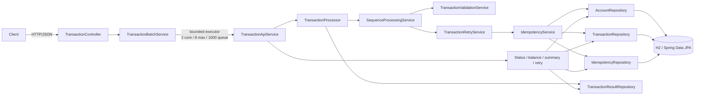

# Transaction Processor — Architecture and Technical Decisions

## 1. Purpose and scope

This document describes the architecture and implementation decisions for the CTS FDE L2 transaction-processing
assessment. The service demonstrates validation, per-account sequencing, idempotent execution, synchronous retry
policy, asynchronous batch acceptance, and status queries.

Accounts, transactions, and idempotency records use Spring Data JPA with the configured H2 in-memory database.
Per-account sequence state is derived from the persisted transaction rows. Submission/execution results and queued
batch work remain in memory. H2 state is lost when the application stops. Database transactions, unique keys, and
account-row locks protect operations within the running database; this setup is not durable or intended for distributed
production deployment.

## 2. System context and architecture



### Component responsibilities

| Component | Responsibility |
|---|---|
| `TransactionController` | Maps REST routes and validated request DTOs to API operations; returns acknowledgements and query results. |
| `TransactionBatchService` | Converts request DTOs to domain objects, creates a batch ID, submits work to the executor, and isolates unexpected record-level failures. |
| `AsyncBatchConfiguration` | Configures a bounded worker pool: 2 core threads, 8 maximum threads, and a queue capacity of 1000. |
| `TransactionApiService` | Bridges HTTP operations and the processing services; persists transaction status, performs queries, and gates manual retry. |
| `TransactionProcessor` | Coordinates a single submission, result persistence, logging, and pending-sequence recovery. Processes each item in a batch individually. |
| `TransactionValidationService` | Validates domain fields and reversal-specific rules and returns an error list rather than throwing for ordinary invalid records. |
| `SequenceProcessingService` | Buffers and orders records per account, reports gaps, checks sequence-slot duplicates/conflicts, and drains consecutive records. |
| `TransactionRetryService` | Runs transaction execution attempts and updates retry state; the configured retry count is three retries after the initial attempt. |
| `IdempotencyService` | Checks request and business keys, calculates balance deltas, validates reversal conditions, and applies balance changes once. |
| Spring Data JPA repositories | `AccountRepository`, `TransactionRepository`, and `IdempotencyRepository` expose persistence/query operations only; `IdempotencyService` owns idempotency and balance business logic. Request-key records use a separate Spring Data repository. |
| `TransactionResultRepository` | Retains submission/execution results in in-memory concurrent maps. |

The model uses `Transaction`, `TransactionType`, and `TransactionStatus`. API request/response types live under
`api/dto`; application logic is under `service`; repository implementations are under `repository`.

## 3. Request and processing flow

```mermaid
sequenceDiagram
    participant C as Client
    participant R as REST API
    participant Q as Bounded batch executor
    participant P as TransactionProcessor
    participant S as SequenceProcessingService
    participant V as TransactionValidationService
    participant T as TransactionRetryService
    participant I as IdempotencyService
    participant A as Account / transaction stores

    C->>R: POST /api/transactions/batch
    R->>Q: enqueue accepted transaction list
    R-->>C: 202 Accepted + batchId
    Q->>P: process records individually, in submission order
    P->>S: submit transaction
    S->>V: validate record
    alt Not sequenceable
        S-->>P: UNSEQUENCABLE + validation errors
    else Account and positive sequence are usable
        S->>S: buffer / compare sequence slot
        alt Predecessor is missing
            S-->>P: BUFFERED + missing sequences
        else Next expected sequence is available
            S->>T: process eligible record
            loop Initial attempt + up to 3 retries on transient failures
                T->>I: execute attempt
                I->>A: check idempotency and account; update state/balance
                I-->>T: processed, duplicate, validation, conflict, rejection, or failure
            end
            T-->>S: execution outcome and retry state
            S->>S: record completion and advance expected sequence
            S-->>P: execution details and pending/gap state
        end
    end
    P->>A: persist submission/execution result
```

Each transaction with a business ID is persisted in `RECEIVED` state before it is submitted to the executor. The
`202 Accepted` response confirms that the batch was admitted to the in-memory executor, not that any transaction has
completed. The worker processes list items in order, but that does not imply a globally ordered batch: sequencing is
defined per account. A record waiting on a missing sequence remains persisted as pending work in the transaction table.

Each record is handled independently. A processing exception is logged and represented as a failed outcome where
possible; subsequent batch items are still attempted. Result persistence is also attempted separately from processing,
so a failed result write is logged and returned as an outcome-persistence failure.

## 4. Validation and sequencing decisions

### Validation

The API rejects a missing or empty batch request at the HTTP boundary. Individual transaction DTOs are not cascaded
through Bean Validation as a group: they are converted to domain transactions and validated in the worker's
record-level flow. This is deliberate so a malformed transaction does not prevent other valid batch records from
being accepted and processed.

Per-transaction checks include:

- Non-blank `transactionId`, `accountId`, and `requestId`.
- A supported `TransactionType`.
- A positive `BigDecimal` amount.
- A three-letter uppercase currency code that is a valid ISO 4217 currency.
- A positive `sequenceNumber`.
- `originalTransactionId` for a `REVERSAL`, and no original ID for other types.

The validator returns all discovered errors for an item. A transaction can enter the ordering mechanism only when its
account ID is non-blank and its sequence number is positive. Other invalid records are `UNSEQUENCABLE`, because there
is no safe sequence position to consume.

### Ordering and gap handling

Sequence state is derived per account from transaction rows in `transactions`:

- `nextExpectedSequence` is computed as the first sequence without a terminal transaction, starting at `1`;
- `RECEIVED`, `PROCESSING`, and `RETRY_PENDING` rows are pending entries;
- `PROCESSED`, `DUPLICATE`, `FAILED`, and `INVALID` rows are terminal entries that advance ordering.

The synchronized sequence coordinator checks the persisted account/sequence slot, then drains only while the exact
`nextExpectedSequence` exists. It serializes sequencing within this application process; transaction execution and each
retry attempt use their own repository transaction so one record's failure does not roll back earlier records. The
balance row is pessimistically locked inside the idempotent execution transaction. A future sequence is not executed
before its predecessor. The result reports pending sequences and any missing ranges before pending entries.

An invalid transaction with a usable account and positive sequence is stored as a terminal invalid sequence entry.
When it reaches the head of the sequence, validation errors are recorded and the sequence advances without transaction
execution. This prevents a bad payload from blocking all later valid records for the account.

Submitting the same payload into an occupied or completed account/sequence slot is a duplicate; using the slot for a
different payload is a conflict. Sequence-payload equality compares the business fields and sequence, but not
`requestId`, allowing transport-level request identity to remain separate from the account's sequence assignment.

`recoverPending(accountId)` queries persisted rows and attempts another drain without skipping missing predecessors.
`getPendingTransactions` and the result's `missingSequences` report database-derived state. These states survive
service-object recreation, but not an H2 shutdown.

## 5. Idempotency and transaction semantics

### Two distinct keys

- **Request-level deduplication (`requestId`):** identifies a request attempt. Repeating the same request ID with the
  same transaction and business payload returns a duplicate-request outcome. Reusing the request ID for different
  content is a conflict.
- **Business-level idempotency (`transactionId`):** identifies the business transaction. Re-submitting an already
  processed transaction under a new request ID, with the same business payload, returns a duplicate-transaction
  outcome and does not apply the balance change again. Reusing the business ID with a different payload is a conflict.

Business payload comparison includes account, reversal reference, transaction type, amount, currency, and sequence.
Amounts use `BigDecimal.compareTo`, so numerically equal amounts such as `10.0` and `10.00` compare equal despite
different scales.

Request records and processed business records are stored in separate JPA tables. A request is recorded on successful
processing or when it refers to an already processed business transaction; transient failures are not recorded as
processed requests, allowing a later attempt to execute.

### Balance effects

Amounts use `BigDecimal`; floating-point arithmetic is not used. `CREDIT` adds the amount and `DEBIT` subtracts it.
`REVERSAL` finds a processed original transaction and applies the inverse of its recorded balance delta. The reversal
must use the same account and absolute amount as the original and the original can be reversed only once. The currency
code is validated syntactically and against ISO 4217. Account currency is persisted, but the balance execution path
does not enforce account/transaction currency equality and reversal currency is not compared to the original.

Accounts must already exist in the `accounts` table; there is no account-creation API or default account seed. The
implementation does not enforce insufficient funds, so a debit may produce a negative balance.

### Database transaction and JVM synchronization boundary

`IdempotencyService.process` is synchronized and `@Transactional`. It serializes calls within this JVM and wraps the
transaction row, pessimistically locked account balance, business idempotency record, and request-id record in one
database transaction. Database primary/unique constraints protect transaction IDs, request IDs, and reversal targets
against concurrent writers that do not share the Java monitor. Account balance updates use a pessimistic row lock.

The existing compensation path remains for an exception after balance adjustment, while the enclosing transaction
provides rollback for database writes. The JVM monitor is not a distributed lock. The configured H2 database is
process-local and volatile; this does not provide durability or cross-instance coordination after moving to separate
databases.

## 6. Retry policy and lifecycle

`TransactionRetryService` runs a synchronous loop under a service-wide synchronized method. The initial call uses
retry count `0`. A transient failure increments the count and records `RETRY_PENDING`; processing then immediately
tries again. Count `3` is the maximum retry count, so exhaustion means four total attempts (the initial attempt plus
three retries). There is no backoff, jitter, external scheduler, or durable retry queue.

The built-in simulator makes `TXN-2005` transiently fail at retry count `0` and succeed at the next attempt. Permanent
validation errors are not retried. Duplicate outcomes do not mutate the balance. Retry state includes transaction
status, retry count, and failure reason. The HTTP retry operation is available only for transactions that exhausted
transient retries; it resets the count and attempts the execution again.

The model statuses are `PENDING`, `RECEIVED`, `PROCESSING`, `RETRY_PENDING`, `PROCESSED`, `DUPLICATE`, `INVALID`, and
`FAILED`. The retry service assigns `INVALID` to validation failures. The REST status projection maps terminal invalid
records to `FAILED` in the current API implementation; callers should use the result/error details to distinguish the
reason.

## 7. REST and error handling

The controller exposes:

| Route | Behavior |
|---|---|
| `POST /api/transactions/batch` | Validates a non-empty list, submits asynchronously, returns `202 Accepted`, batch ID, and accepted count. |
| `GET /api/transactions/{transactionId}` | Reads transaction state, retry count, and available failure reason. |
| `GET /api/accounts/{accountId}/balance` | Reads an existing account's current balance. |
| `GET /api/transactions/summary` | Counts stored transaction records by status. |
| `POST /api/transactions/{transactionId}/retry` | Retries an eligible failed transaction; returns a conflict for ineligible state. |

The centralized exception handler maps request validation and malformed bodies to `400`, missing transactions/accounts
to `404`, retry eligibility conflicts to `409`, and executor saturation to `503`. Per-record validation, duplicate,
conflict, and processing failures occur asynchronously and are not represented by changing the initial batch
acknowledgement status. There is no batch-status endpoint; clients query transaction statuses individually.

## 8. Persistence entities and schema assumptions

| Entity/table | Key and stored data | Constraint/decision |
|---|---|---|
| `Transaction` / `transactions` | `transactionId` primary key; request/account IDs, reversal reference, enum type/status, amount, currency, sequence, retry count, timestamps, failure reason | `BigDecimal` precision 19, scale 4; enums stored by name; account/sequence indexed. Validation-sensitive fields are nullable so invalid records can be recorded. |
| `Account` / `accounts` | `accountId` primary key, currency, `BigDecimal` balance | Currency is required and three characters; balance precision 19, scale 4. The legacy `saveBalance(accountId, balance)` adapter assumes USD. |
| `IdempotencyRecord` / `transaction_idempotency` | Business transaction ID primary key/foreign key to `transactions`, balance delta and balance-after snapshot, reversal marker/reference | One row per successfully processed business transaction; reversed transaction reference is unique. |
| `RequestIdempotencyRecord` / `request_idempotency` | Request ID primary key and foreign key to business transaction | Preserves request-level deduplication separately from business-level idempotency. |

`jakarta.persistence.validation.mode=none` disables automatic entity lifecycle validation and Bean Validation-derived
DDL constraints. The application explicitly validates each request through `TransactionValidationService`; nullable
transaction fields allow invalid records with usable sequence data to be persisted and advanced as terminal entries.
The datasource URL is `jdbc:h2:mem:transactiondb`; state lasts only for the application process. `ddl-auto=update` is
assessment configuration, not a production schema migration strategy.

## 9. State storage and consistency

| State | Storage | Lifetime |
|---|---|---|
| Account balances | JPA `accounts` table | Current process (H2 in-memory) |
| Transaction state and retry failure reason | JPA `transactions` table | Current process (H2 in-memory) |
| Business idempotency and request IDs | JPA idempotency tables | Current process (H2 in-memory) |
| Per-account expected sequence and pending/completed entries | Derived from JPA `transactions` rows | Current process (H2 in-memory) |
| Submission/execution results | Result repository concurrent maps | Application process only |
| Accepted batch work | Bounded executor queue | Application process only |

Spring Data repositories expose persistence and query operations; service classes own the processing rules. Unique
transaction/request keys and pessimistic account-row locks reinforce idempotency and balance invariants. Sequence
ordering uses persisted transaction rows plus an in-process synchronized coordinator; cross-instance sequence
coordination requires a dedicated database lock/slot design. Submission/execution result indexing still relies on
in-memory concurrent maps.

## 10. Important trade-offs

| Decision | Benefit | Limitation |
|---|---|---|
| H2 in-memory database | Real JPA mappings and database transaction behavior without external setup | All data is lost at shutdown; no durable audit or deployment-grade availability. |
| Database-derived sequence state | Recovery after service-object recreation and one source of truth for pending work | Sequence scans add database work; the ordering monitor is local to one JVM and H2 state is lost at shutdown. |
| In-memory submission/execution result store | Preserves the existing result lookup API without another persistence model | Result history is lost at restart and cannot serve as a durable audit trail. |
| Global synchronized idempotency and retry methods | Straightforward in-process protection of idempotency invariants | Serializes transaction executions across accounts and limits throughput; Java monitor is local to one JVM. |
| Synchronous retries | Easy-to-test deterministic retry lifecycle | A worker thread remains occupied; no delay/backoff, scheduling, or process recovery. |
| Bounded asynchronous executor | Keeps batch submission responsive and limits queued work | Acceptance is not durable; queue saturation produces `503`; no persistent batch progress state. |
| Terminal invalid sequence entries | Invalid payloads do not stall the account stream | Requires account and positive sequence to be trustworthy; malformed/unsequenceable items cannot advance it. |
| Per-transaction validation in worker | Isolates errors to the individual record | Clients receive acceptance before record-level validation results and must query transaction state. |

## 11. Production evolution

To harden this design while preserving its processing model:

1. Replace H2 in-memory storage with a durable relational database or ledger store. Keep balance changes, transaction
   state, idempotency records, request records, and reversal markers in one database transaction; persist execution
   results and accepted batch work as well.
2. Keep unique constraints for `transactionId` and request keys. If sequence-slot assignment must be coordinated
   across instances, add a dedicated slot/lock table; use optimistic versions or account-row locking for balance
   updates. For multi-node workers, rely on database coordination rather than JVM monitors.
3. Introduce durable batch scheduling and startup reconciliation for accepted work that was not completed before a
   restart. Sequence ordering itself is derived from transaction rows.
4. Put accepted batches in a durable queue or transactional outbox. Persist batch lifecycle and provide a batch status
   endpoint. Define idempotent consumer and dead-letter behavior.
5. Schedule retries durably with exponential backoff and jitter; classify retryable failures explicitly and expose
   operational controls for poison records.
6. Define currency ownership and scale/rounding rules, insufficient-funds behavior, reversal authorization and
   lifecycle, retention, and audit requirements.
7. Add authentication and authorization, request-size limits, rate limits, structured observability, tracing, metrics,
   health checks, and alerts. Ensure logs do not disclose sensitive transaction payloads.

## 12. Verification

The automated tests cover validation and record isolation, sequence buffering/draining/gap reporting, idempotency and
concurrent duplicate requests, reversal and balance behavior, retry success/exhaustion, processing orchestration, and
REST endpoint behavior. A Spring Boot integration test also verifies account, transaction, and idempotency data through
the H2-backed repositories. Run the suite with:

```shell
.\mvnw.cmd test
```
