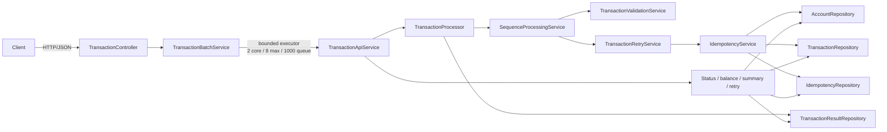

# Transaction Processor — Architecture and Technical Decisions

## 1. Purpose and scope

This document describes the architecture and implementation decisions for the CTS FDE L2 transaction-processing
assessment. The service demonstrates validation, per-account sequencing, idempotent execution, synchronous retry
policy, asynchronous batch acceptance, and status queries.

The implementation is intentionally an in-memory reference application. Its synchronization provides protection
within one JVM, but it does not provide durable storage, cross-instance coordination, or database-grade atomicity.
Production requirements and the migration path are described below.

## 2. System context and architecture



### Component responsibilities

| Component | Responsibility |
|---|---|
| `TransactionController` | Maps REST routes and validated request DTOs to API operations; returns acknowledgements and query results. |
| `TransactionBatchService` | Converts request DTOs to domain objects, creates a batch ID, submits work to the executor, and isolates unexpected record-level failures. |
| `AsyncBatchConfiguration` | Configures a bounded worker pool: 2 core threads, 8 maximum threads, and a queue capacity of 1000. |
| `TransactionApiService` | Bridges HTTP operations and the processing services; persists transaction status, performs queries, and gates manual retry. |
| `TransactionProcessor` | Coordinates a single submission, result persistence, logging, and pending-sequence recovery. Processes each item in a batch individually. |
| `TransactionValidationService` | Validates domain fields and reversal-specific rules and returns an error list rather than throwing for ordinary invalid records. |
| `SequenceProcessingService` | Buffers and orders records per account, reports gaps, checks sequence-slot duplicates/conflicts, and drains consecutive records. |
| `TransactionRetryService` | Runs transaction execution attempts and updates retry state; the configured retry count is three retries after the initial attempt. |
| `IdempotencyService` | Checks request and business keys, calculates balance deltas, validates reversal conditions, and applies balance changes once. |
| Repositories | Encapsulate in-memory storage for accounts, transaction state, idempotency/retry state, and submission/execution results. |

The model uses `Transaction`, `TransactionType`, and `TransactionStatus`. API request/response types live under
`api/dto`; application logic is under `service`; repository implementations are under `repository`.

## 3. Request and processing flow

```mermaid
sequenceDiagram
    participant C as Client
    participant R as REST API
    participant Q as Bounded batch executor
    participant P as TransactionProcessor
    participant S as SequenceProcessingService
    participant V as TransactionValidationService
    participant T as TransactionRetryService
    participant I as IdempotencyService
    participant A as Account / transaction stores

    C->>R: POST /api/transactions/batch
    R->>Q: enqueue accepted transaction list
    R-->>C: 202 Accepted + batchId
    Q->>P: process records individually, in submission order
    P->>S: submit transaction
    S->>V: validate record
    alt Not sequenceable
        S-->>P: UNSEQUENCABLE + validation errors
    else Account and positive sequence are usable
        S->>S: buffer / compare sequence slot
        alt Predecessor is missing
            S-->>P: BUFFERED + missing sequences
        else Next expected sequence is available
            S->>T: process eligible record
            loop Initial attempt + up to 3 retries on transient failures
                T->>I: execute attempt
                I->>A: check idempotency and account; update state/balance
                I-->>T: processed, duplicate, validation, conflict, rejection, or failure
            end
            T-->>S: execution outcome and retry state
            S->>S: record completion and advance expected sequence
            S-->>P: execution details and pending/gap state
        end
    end
    P->>A: persist submission/execution result
```

The `202 Accepted` response confirms that the batch was admitted to the in-memory executor, not that any transaction
has completed. The worker processes list items in order, but that does not imply a globally ordered batch: sequencing
is defined per account. A record waiting on a missing sequence remains buffered in the sequence service.

Each record is handled independently. A processing exception is logged and represented as a failed outcome where
possible; subsequent batch items are still attempted. Result persistence is also attempted separately from processing,
so a failed result write is logged and returned as an outcome-persistence failure.

## 4. Validation and sequencing decisions

### Validation

The API rejects a missing or empty batch request at the HTTP boundary. Individual transaction DTOs are not cascaded
through Bean Validation as a group: they are converted to domain transactions and validated in the worker's
record-level flow. This is deliberate so a malformed transaction does not prevent other valid batch records from
being accepted and processed.

Per-transaction checks include:

- Non-blank `transactionId`, `accountId`, and `requestId`.
- A supported `TransactionType`.
- A positive `BigDecimal` amount.
- A three-letter uppercase currency code that is a valid ISO 4217 currency.
- A positive `sequenceNumber`.
- `originalTransactionId` for a `REVERSAL`, and no original ID for other types.

The validator returns all discovered errors for an item. A transaction can enter the ordering mechanism only when its
account ID is non-blank and its sequence number is positive. Other invalid records are `UNSEQUENCABLE`, because there
is no safe sequence position to consume.

### Ordering and gap handling

Sequence state is held per account in a concurrent map. Each account state has:

- `nextExpectedSequence`, initialized to `1`;
- a sorted map of pending sequence numbers to transaction/validation snapshots;
- a sorted map of completed sequence numbers to their execution results.

The service synchronizes on the account's sequence state. Submission inserts an eligible item into `pending`, then
drains only while the exact `nextExpectedSequence` exists. The completed entry is recorded and the expected value is
advanced after each drained item. A future sequence is not executed before its predecessor. The result reports pending
sequences and any missing ranges before pending entries.

An invalid transaction with a usable account and positive sequence is stored as a terminal invalid sequence entry.
When it reaches the head of the sequence, validation errors are recorded and the sequence advances without transaction
execution. This prevents a bad payload from blocking all later valid records for the account.

Submitting the same payload into an occupied or completed account/sequence slot is a duplicate; using the slot for a
different payload is a conflict. Sequence-payload equality compares the business fields and sequence, but not
`requestId`, allowing transport-level request identity to remain separate from the account's sequence assignment.

`recoverPending(accountId)` attempts another drain but will not skip missing predecessors. `getPendingTransactions` and
the result's `missingSequences` expose the current in-memory state to internal callers. Neither recovery state nor
the next expected sequence survives restart.

## 5. Idempotency and transaction semantics

### Two distinct keys

- **Request-level deduplication (`requestId`):** identifies a request attempt. Repeating the same request ID with the
  same transaction and business payload returns a duplicate-request outcome. Reusing the request ID for different
  content is a conflict.
- **Business-level idempotency (`transactionId`):** identifies the business transaction. Re-submitting an already
  processed transaction under a new request ID, with the same business payload, returns a duplicate-transaction
  outcome and does not apply the balance change again. Reusing the business ID with a different payload is a conflict.

Business payload comparison includes account, reversal reference, transaction type, amount, currency, and sequence.
Amounts use `BigDecimal.compareTo`, so numerically equal amounts such as `10.0` and `10.00` compare equal despite
different scales.

Request records and processed business records are stored in separate maps. A request is recorded on successful
processing or when it refers to an already processed business transaction; transient failures are not recorded as
processed requests, allowing a later attempt to execute.

### Balance effects

Amounts use `BigDecimal`; floating-point arithmetic is not used. `CREDIT` adds the amount and `DEBIT` subtracts it.
`REVERSAL` finds a processed original transaction and applies the inverse of its recorded balance delta. The reversal
must use the same account and absolute amount as the original and the original can be reversed only once. The currency
code is validated syntactically and against ISO 4217, but account currency is not modeled and reversal currency is not
compared to the original transaction's currency.

Accounts must already exist in `AccountRepository`; there is no account-creation API or default account seed. The
implementation does not enforce insufficient funds, so a debit may produce a negative balance.

### In-memory atomicity boundary

`IdempotencyService.process` is synchronized. In this application, it serializes duplicate checks, account adjustment,
transaction persistence, and idempotency recording across all executing threads in that service instance. This prevents
two in-process threads from passing the same idempotency check and both applying the same balance delta.

The operation adjusts the balance, persists transaction state and idempotency records, and compensates the balance if
subsequent in-memory recording throws. Compensation is best-effort: if the restoring operation also fails, that error
is suppressed onto the original exception. This is not equivalent to an ACID transaction; process termination,
multiple application instances, or partial repository failure can still produce inconsistent state.

## 6. Retry policy and lifecycle

`TransactionRetryService` runs a synchronous loop under a service-wide synchronized method. The initial call uses
retry count `0`. A transient failure increments the count and records `RETRY_PENDING`; processing then immediately
tries again. Count `3` is the maximum retry count, so exhaustion means four total attempts (the initial attempt plus
three retries). There is no backoff, jitter, external scheduler, or durable retry queue.

The built-in simulator makes `TXN-2005` transiently fail at retry count `0` and succeed at the next attempt. Permanent
validation errors are not retried. Duplicate outcomes do not mutate the balance. Retry state includes transaction
status, retry count, and failure reason. The HTTP retry operation is available only for transactions that exhausted
transient retries; it resets the count and attempts the execution again.

The model statuses are `PENDING`, `RECEIVED`, `PROCESSING`, `RETRY_PENDING`, `PROCESSED`, `DUPLICATE`, `INVALID`, and
`FAILED`. The retry service assigns `INVALID` to validation failures. The REST status projection maps terminal invalid
records to `FAILED` in the current API implementation; callers should use the result/error details to distinguish the
reason.

## 7. REST and error handling

The controller exposes:

| Route | Behavior |
|---|---|
| `POST /api/transactions/batch` | Validates a non-empty list, submits asynchronously, returns `202 Accepted`, batch ID, and accepted count. |
| `GET /api/transactions/{transactionId}` | Reads transaction state, retry count, and available failure reason. |
| `GET /api/accounts/{accountId}/balance` | Reads an existing account's current balance. |
| `GET /api/transactions/summary` | Counts stored transaction records by status. |
| `POST /api/transactions/{transactionId}/retry` | Retries an eligible failed transaction; returns a conflict for ineligible state. |

The centralized exception handler maps request validation and malformed bodies to `400`, missing transactions/accounts
to `404`, retry eligibility conflicts to `409`, and executor saturation to `503`. Per-record validation, duplicate,
conflict, and processing failures occur asynchronously and are not represented by changing the initial batch
acknowledgement status. There is no batch-status endpoint; clients query transaction statuses individually.

## 8. State storage and consistency

| State | In-memory representation | Current durability |
|---|---|---|
| Account balances | Account repository | None |
| Transaction state | Transaction repository | None |
| Business idempotency, request IDs, reversal markers, retry state | Idempotency repository | None |
| Per-account expected sequence, pending and completed entries | Sequence service | None |
| Submission/execution results | Result repository | None |
| Accepted batch work | Bounded executor queue | None |

Repositories return/capture transaction snapshots where implemented to reduce accidental mutation of stored values.
Concurrent maps protect individual in-memory operations. Higher-level invariants depend on synchronized service
operations and are not enforced by shared storage constraints.

## 9. Important trade-offs

| Decision | Benefit | Limitation |
|---|---|---|
| In-memory repositories | Small setup, quick assessment execution, deterministic unit tests | State is lost on restart; no multi-node consistency or audit durability. |
| Per-account sequence monitor | Independent accounts can sequence concurrently; simple no-gap ordering | A sequence drain holds the account monitor while executing records; pending/completed history is unbounded. |
| Global synchronized idempotency and retry methods | Straightforward in-process protection of balance/idempotency invariants | Serializes transaction executions across accounts and limits throughput. |
| Synchronous retries | Easy-to-test deterministic retry lifecycle | A worker thread remains occupied; no delay/backoff, scheduling, or process recovery. |
| Bounded asynchronous executor | Keeps batch submission responsive and limits queued work | Acceptance is not durable; queue saturation produces `503`; no persistent batch progress state. |
| Terminal invalid sequence entries | Invalid payloads do not stall the account stream | Requires account and positive sequence to be trustworthy; malformed/unsequenceable items cannot advance it. |
| Per-transaction validation in worker | Isolates errors to the individual record | Clients receive acceptance before record-level validation results and must query transaction state. |

## 10. Production evolution

To harden this design while preserving its processing model:

1. Replace in-memory repositories with a relational database or ledger store. Apply balance changes, transaction state,
   idempotency records, request records, reversal markers, and execution results in one database transaction.
2. Add unique constraints for `transactionId`, `requestId`, and `(accountId, sequenceNumber)`. Use optimistic versions
   or account-row locking for balance and sequence advancement. For multi-node workers, rely on database coordination
   or a properly scoped distributed lock rather than JVM monitors.
3. Persist `nextExpectedSequence` and pending records. Introduce startup recovery and reconciliation for accepted work
   that was not completed before a restart.
4. Put accepted batches in a durable queue or transactional outbox. Persist batch lifecycle and provide a batch status
   endpoint. Define idempotent consumer and dead-letter behavior.
5. Schedule retries durably with exponential backoff and jitter; classify retryable failures explicitly and expose
   operational controls for poison records.
6. Define currency ownership and scale/rounding rules, insufficient-funds behavior, reversal authorization and
   lifecycle, retention, and audit requirements.
7. Add authentication and authorization, request-size limits, rate limits, structured observability, tracing, metrics,
   health checks, and alerts. Ensure logs do not disclose sensitive transaction payloads.

## 11. Verification

The automated tests cover validation and record isolation, sequence buffering/draining/gap reporting, idempotency and
concurrent duplicate requests, reversal and balance behavior, retry success/exhaustion, processing orchestration, and
REST endpoint behavior. Run the suite with:

```shell
.\mvnw.cmd test
```
