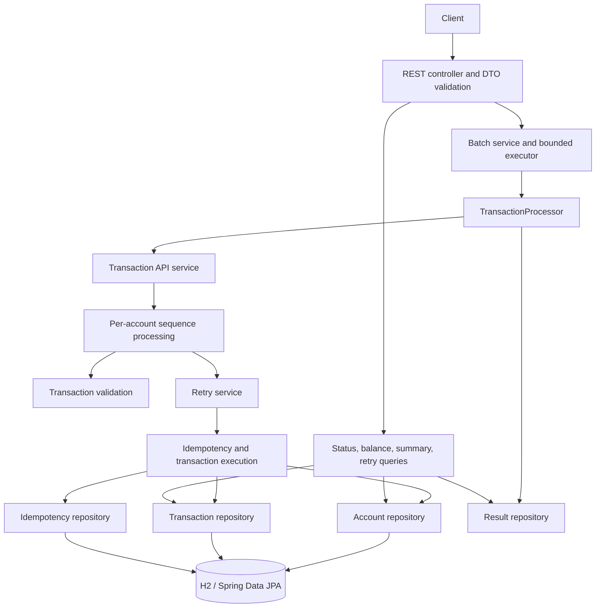

# CTS FDE L2 Assessment — Transaction Processor

A Spring Boot transaction-processing service that accepts transaction batches, validates records, orders them by
account sequence, prevents duplicate balance changes, retries simulated transient failures, and exposes processing
status and account balances over REST.

> **Assessment implementation:** accounts, transactions, and idempotency records use Spring Data JPA with an H2
> in-memory database. Accepted transactions and sequence state are derived from persisted transaction rows;
> submission results and the batch queue remain in memory. All database state
> is lost when the application stops; this is not a durable ledger or production banking system.

## Problem statement

Transaction requests can arrive out of order, be delivered more than once, contain invalid values, or fail transiently
while being processed. The system must process valid transactions in sequence, avoid applying the same business
transaction twice, isolate record-level failures, and provide clients with useful acknowledgements and status.

## Business requirements

- Validate transaction IDs, request IDs, account IDs, positive amounts, ISO 4217 currencies, supported transaction
  types, and positive sequence numbers.
- Process each account's transactions in ascending sequence order, starting at sequence `1`. Buffer future sequences
  and report gaps instead of processing them early.
- Treat a record with usable account and sequence identifiers but invalid transaction fields as terminal for
  sequencing, so it cannot block later records.
- Use `transactionId` as the business idempotency key and track `requestId` separately. Reject a reused transaction ID
  with a different business payload.
- Execute `CREDIT`, `DEBIT`, and `REVERSAL` using `BigDecimal`; do not apply duplicate balance updates.
- Retry transient failures up to **3 retries** after the initial attempt; persist retry count and failure reason.
- Isolate batch records so an invalid or failed record does not stop the rest of the batch.
- Return meaningful HTTP status codes and structured error responses.

## Architecture



The REST layer maps JSON DTOs to domain transactions. `TransactionProcessor` coordinates submission and result
recording. `SequenceProcessingService` owns ordering and buffering; it invokes transaction execution only when the
next expected sequence is present. `TransactionRetryService` owns attempt state and retry policy. `IdempotencyService`
checks request and business keys, calculates balance deltas, and coordinates account and transaction state.
Spring Data repositories persist accounts, transaction state, and idempotency records in H2; sequence and result
repositories remain in memory.

## Technology stack

- Java 17 language target
- Spring Boot 4.2 snapshot, Spring MVC, and Jackson
- Spring Data JPA, Hibernate, and H2
- Jakarta Bean Validation
- Maven Wrapper
- JUnit 5 and Spring MVC test support
- SLF4J logging

## Package structure

```text
src/main/java/com/cts/transaction_processor/
├── TransactionProcessorApplication.java
├── api/                 # HTTP controllers, orchestration, errors, async executor
│   └── dto/             # Request and response DTOs
├── model/               # JPA entities, transaction type, and lifecycle status
├── repository/          # Spring Data JPA repositories and in-memory result store
└── service/             # Validation, sequencing, retries, execution, and processing

src/test/java/com/cts/transaction_processor/
├── TransactionProcessorApplicationTests.java
├── api/                 # REST integration tests
└── service/             # Unit tests for validation, sequence, idempotency, retries, and processing

transactions.json        # CTS assessment sample batch
```

## Idempotency and duplicate detection

`requestId` identifies an individual request attempt. Repeating the same request ID and payload is request-level
deduplication. `transactionId` identifies the business transaction: resubmitting the same transaction with a new
request ID is a business-level duplicate and must not apply its balance delta again. Reusing the transaction ID with
a different business payload is a conflict. An account/sequence slot is also protected from a second, different record.

Processed business keys and request IDs are stored in the `transaction_idempotency` and `request_idempotency` tables;
the business transaction is stored in `transactions`. Database primary/unique keys backstop the in-process synchronized
idempotency service, while account balance changes use a pessimistic account-row lock inside a JPA transaction. This
prevents duplicate updates against the same running database, but the configured H2 database is volatile and is not
shared across service restarts or distributed deployments.

## Sequence ordering

Sequence state is maintained separately for each account and begins at `1`. For example, sequence `2` submitted before
sequence `1` is buffered and reports `1` as missing. Arrival of sequence `1` processes it first, then drains sequence
`2`. Future records remain available through the service's pending-record and recovery methods until their gaps close.
Pending and completed sequence positions are derived from persisted transaction rows, so ordering and pending-record
recovery survive service-object recreation while the H2 database remains running. Sequence details are not exposed as
a REST endpoint.

Invalid records with a usable account ID and positive sequence number are terminal sequence entries. They return
validation errors and advance the expected sequence; records without those identifiers cannot be ordered. The sequence
result uses `INVALID` for terminal validation failures; the current transaction-status endpoint represents terminal
invalid records as `FAILED`.

## Retries and transaction lifecycle

The lifecycle includes `PENDING`, `RECEIVED`, `PROCESSING`, `RETRY_PENDING`, `PROCESSED`, `DUPLICATE`, `INVALID`, and
`FAILED`. On a transient error, retry processing records `RETRY_PENDING`, increments the retry count, and logs the
reason. A successful attempt ends at `PROCESSED`; exhausting three retries ends at `FAILED`. Permanent validation
errors are not retried. The built-in simulator fails `TXN-2005` transiently on its initial attempt and allows the next
attempt to succeed.

The retry endpoint applies to transactions that exhausted transient retries. It does not retry invalid or arbitrary
failed records.

## REST API

All endpoints are under `/api`.

| Method and path | Description | Success |
|---|---|---|
| `POST /transactions/batch` | Accept a non-empty batch for background processing | `202 Accepted` |
| `GET /transactions/{transactionId}` | Read transaction status, retry count, and failure reason | `200 OK` |
| `GET /accounts/{accountId}/balance` | Read an existing account's balance | `200 OK` |
| `GET /transactions/summary` | Return total transactions and counts by status | `200 OK` |
| `POST /transactions/{transactionId}/retry` | Retry a transaction eligible after transient retry exhaustion | `200 OK` |

### Submit a batch

```http
POST {{baseUrl}}/api/transactions/batch
Content-Type: application/json
```

The request contains a non-empty `transactions` array. Each record requires `transactionId`, `requestId`, `accountId`,
`transactionType`, `amount`, `currency`, and `sequenceNumber`. `originalTransactionId` is required for a reversal.
Transaction fields are validated independently during background processing so a bad record does not reject the whole
batch. Amounts must be positive; an invalid amount is terminal at the sequence-processing layer.

```json
{
  "transactions": [
    {
      "transactionId": "TXN-2001",
      "requestId": "REQ-1",
      "accountId": "ACC-201",
      "transactionType": "CREDIT",
      "amount": 100.00,
      "currency": "USD",
      "sequenceNumber": 1
    }
  ]
}
```

The server acknowledges queue acceptance; it does not wait for processing:

```http
HTTP/1.1 202 Accepted
Content-Type: application/json
```

```json
{
  "batchId": "<server-generated UUID>",
  "status": "ACCEPTED",
  "acceptedCount": 1,
  "acceptedAt": "<server-generated ISO-8601 timestamp>",
  "message": "Batch accepted for background processing"
}
```

`batchId` and `acceptedAt` are generated per call. `acceptedCount` is the submitted array size. This response means
the rows were accepted and the batch was queued; it does not claim that background processing has completed. The
worker processes records individually. Per-record outcomes are available through the transaction endpoint; there is
no batch-status endpoint.

### Read transaction status

```http
GET {{baseUrl}}/api/transactions/TXN-2001
```

```json
{
  "transactionId": "TXN-2001",
  "accountId": "ACC-201",
  "sequenceNumber": 1,
  "transactionType": "CREDIT",
  "amount": 100.00,
  "currency": "USD",
  "status": "PROCESSED",
  "retryCount": 0,
  "failureReason": null
}
```

This response is serialized from the persisted `Transaction` row; amounts, state, retry count, and failure reason
reflect H2 at read time. Returns `404 Not Found` when the transaction is unknown.

### Read an account balance

```http
GET {{baseUrl}}/api/accounts/ACC-201/balance
```

```json
{
  "accountId": "ACC-201",
  "balance": 100.00
}
```

The balance is read from the persisted account row and changes only when a unique business transaction commits.
Returns `404 Not Found` if the account has not been initialized.

### Read transaction summary

```http
GET {{baseUrl}}/api/transactions/summary
```

```json
{
  "total": 1,
  "countsByStatus": {
    "PENDING": 0,
    "RECEIVED": 0,
    "PROCESSING": 0,
    "RETRY_PENDING": 0,
    "PROCESSED": 1,
    "DUPLICATE": 0,
    "INVALID": 0,
    "FAILED": 0
  }
}
```

Counts are queried from persisted transaction rows when the request is handled. The example represents a database
containing one `PROCESSED` transaction; live values vary with the contents of H2.

### Retry a failed transaction

```http
POST {{baseUrl}}/api/transactions/TXN-2005/retry
```

Only a persisted `FAILED` transaction whose retry count exhausted the configured transient retry allowance is
eligible. The handler returns `200 OK` with the actual `SequenceProcessingResult` shape:

```json
{
  "accountId": "ACC-203",
  "submittedSequence": 5,
  "status": "PROCESSED",
  "message": "Transaction processed",
  "nextExpectedSequence": 6,
  "missingSequences": [],
  "pendingSequences": [],
  "executions": [
    {
      "sequenceNumber": 5,
      "transactionId": "TXN-2005",
      "terminalInvalid": false,
      "executionResult": {
        "status": "PROCESSED",
        "message": "Transaction processed",
        "balance": 500.00,
        "errors": [],
        "transactionStatus": "PROCESSED",
        "retryCount": 1,
        "failureReason": null
      },
      "errors": []
    }
  ],
  "errors": []
}
```

For the example above, this assumes `ACC-203` starts with a zero balance; balance is read from the persisted account
after the retry succeeds.

This example shows the built-in `TXN-2005` transient failure on the initial retry attempt followed by success. The
transaction status and retry count are persisted by the retry service; if the business idempotency record already
exists, retry does not apply its balance delta again. Unknown transaction IDs return `404 Not Found`; transactions
not eligible for retry return `409 Conflict`.

The default batch simulator automatically retries `TXN-2005` and succeeds on its second attempt, so it does not
naturally produce a transaction eligible for this manual-retry endpoint. The successful response above assumes the
database already contains a `FAILED` transaction with its retry allowance exhausted.

### Postman error responses

The error DTO is consistent across routes. An empty batch returns `400 Bad Request`:

```json
{
  "timestamp": "<server-generated ISO-8601 timestamp>",
  "status": 400,
  "error": "Bad Request",
  "message": "Request validation failed",
  "path": "/api/transactions/batch",
  "details": [
    "transactions must contain at least one transaction"
  ]
}
```

Unknown transaction or account IDs return `404 Not Found`; for example, `GET {{baseUrl}}/api/transactions/missing`:

```json
{
  "timestamp": "<server-generated ISO-8601 timestamp>",
  "status": 404,
  "error": "Not Found",
  "message": "Transaction not found: missing",
  "path": "/api/transactions/missing",
  "details": []
}
```

Reusing a transaction ID with a different payload returns `409 Conflict` from batch submission:

```json
{
  "timestamp": "<server-generated ISO-8601 timestamp>",
  "status": 409,
  "error": "Conflict",
  "message": "transactionId is already associated with a different payload",
  "path": "/api/transactions/batch",
  "details": []
}
```

A retry request for a transaction that has not exhausted transient retries also returns `409 Conflict`:

```json
{
  "timestamp": "<server-generated ISO-8601 timestamp>",
  "status": 409,
  "error": "Conflict",
  "message": "Transaction is not eligible for retry",
  "path": "/api/transactions/TXN-2001/retry",
  "details": []
}
```

`{{baseUrl}}` is a Postman environment variable, for example `http://localhost:8080`. Initialize accounts before
submitting records; the application does not provide an account-creation route. A full async queue returns `503`.

## Run the application

Prerequisites: JDK 17 or newer. The Maven Wrapper downloads and uses the project's configured Maven version.

```shell
# Windows PowerShell
.\mvnw.cmd test
.\mvnw.cmd spring-boot:run

# macOS/Linux
./mvnw test
./mvnw spring-boot:run
```

The HTTP server listens on port `8080` by default. Initialize accounts through the account repository before submitting
transactions; this assessment implementation does not include an account-creation endpoint or seed account data.

## CTS assessment sample

[`transactions.json`](transactions.json) contains the six supplied sample records in arrival order, including the
duplicate `TXN-2002`, the invalid negative amount on `TXN-2004`, and `TXN-2005` for transient retry simulation.
Submit it as the body of `POST /api/transactions/batch`. The API accepts the batch asynchronously; to observe normal
balance processing, initialize the sample accounts first. In particular, results also depend on each account's
sequence stream starting at `1`. `TXN-2005` only reaches the transient-failure simulator if its account's preceding
sequence numbers have also been supplied or processed.

## Unit and integration tests

```shell
.\mvnw.cmd test
```

The Spring Boot JPA integration tests use a separate H2 database named
`transaction-persistence-tests`; they verify persisted transaction acceptance, same-business-key duplicate handling,
balance-once behavior, out-of-order sequencing, negative-amount rejection, the `TXN-2005` transient retry, persisted
status and summary reads, and the database primary-key constraint. The REST tests also exercise the controller
contracts. Run only the persistence integration tests with:

```shell
.\mvnw.cmd "-Dtest=TransactionJpaPersistenceTests" test
```

Tests cover transaction validation, invalid-record isolation, out-of-order sequence buffering/draining and missing
sequence reporting, idempotency and concurrent duplicate requests, retry success/exhaustion/permanent validation
errors, balance updates, transaction orchestration, and REST endpoint behavior.

## Assumptions and trade-offs

- Sequence numbers are contiguous and start at `1` **per account**.
- A sequence-invalid record can only advance ordering if both account ID and positive sequence number are usable.
- The sample application starts with no accounts; account balances must be created by an embedding system or test setup.
- Currency codes are checked against ISO 4217. Account currency is persisted, but the legacy
  `saveBalance(accountId, balance)` method assumes USD; cross-currency conversion is not supported.
- A reversal references a processed original transaction and applies the inverse delta once.
- Debits are not constrained by an insufficient-funds rule; balances may become negative.
- The transient failure is deterministic assessment scaffolding for `TXN-2005`.
- H2 and remaining in-memory collections prioritize a runnable assessment implementation over durable storage,
  distributed deployment, and operational recovery. Account, transaction, sequence, and idempotency state is stored
  in H2; asynchronous batch work and submission/execution result indexing are not durable.

## Production hardening

Before production use:

1. Replace H2 in-memory storage with a durable database and move pending batch work and submission/execution results
   into durable storage. Atomically update account balances, transaction status, idempotency keys, and reversal markers
   in one ACID transaction.
2. Enforce unique constraints for business `transactionId` and request keys. Coordinate account/sequence-slot claims
   with database locking or a dedicated slot table, and use row locks or optimistic versions for concurrent workers.
3. Persist pending sequences and retry metadata. Use a durable queue/outbox, retry scheduling with backoff and jitter,
   dead-letter handling, and restart recovery.
4. Define account provisioning, currency ownership, debit limits/insufficient funds, reversal authorization, and
   retention/audit policies.
5. Add authentication/authorization, rate limits, request size limits, tracing/metrics, health checks, and operational
   alerting. Avoid exposing sensitive payloads in logs.
6. Make batch job identity and completion queryable; distinguish accepted, running, partially complete, and complete
   batch states.

The current synchronization is JVM-local. It prevents duplicate balance updates among threads sharing these service
instances, but it does not create a distributed lock or replace database transaction guarantees.

## AI-assisted development disclosure

GitHub Copilot was used as an AI-assisted development tool to help draft and refine implementation and assessment
documentation. The resulting code and documentation were reviewed and validated with the project's automated tests.
